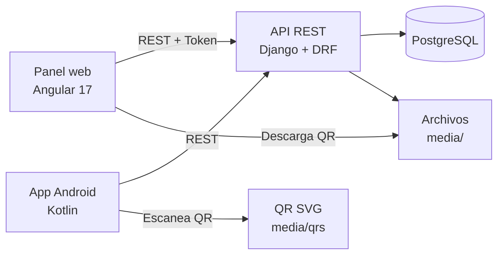

# QR Picker

Plataforma para la gestión de perfiles personales, galerías multimedia y códigos QR. El sistema permite registrar personas, organizar su contenido (fotografías, videos, estudios e intereses) y generar un código QR por galería que, al ser escaneado desde la aplicación Android, abre el perfil completo de la persona.

El repositorio integra tres aplicaciones independientes que comparten una misma API REST:

- **API backend** — Django + Django REST Framework.
- **Panel de administración web** — Angular 17 + PrimeNG.
- **Aplicación móvil** — Android nativo con Kotlin.


---

## Tabla de contenido

- [Arquitectura](#arquitectura)
- [Stack tecnológico](#stack-tecnológico)
- [Estructura del repositorio](#estructura-del-repositorio)
- [Puesta en marcha](#puesta-en-marcha)
  - [Requisitos previos](#requisitos-previos)
  - [1. Backend](#1-backend)
  - [2. Panel web](#2-panel-web)
  - [3. Aplicación Android](#3-aplicación-android)

---

## Arquitectura



| Componente | Directorio | Responsabilidad |
|---|---|---|
| API REST | `qr_images_server/` | Autenticación por token, CRUD de perfiles, galerías, recursos, estudios e intereses; generación de códigos QR en SVG. |
| Panel web | `qr_picker_view/` | Registro e inicio de sesión, administración de perfiles y carga de contenido; descarga del QR de cada galería. |
| App móvil | `qrapp/` | Escaneo de QR con ZXing, consulta del perfil a la API y visualización de galerías, estudios e intereses. |

La comunicación es exclusivamente HTTP/JSON (con `multipart/form-data` para la subida de archivos). La API se expone bajo el prefijo `/api/` y los archivos multimedia bajo `/media/`. Cada galería genera un QR SVG con los datos `id_galeria`, `id_persona`, `nombre_galeria` y `estado`; la app Android lo valida y consulta el perfil mediante `id_persona`.

---

## Stack tecnológico

| Capa | Tecnologías |
|---|---|
| **Backend** | Python, Django 4.2.1, Django REST Framework 3.15.2, PostgreSQL (`psycopg2`), Pillow, `qrcode` 7.4.2, `django-cors-headers` |
| **Frontend web** | Angular 17 (standalone components), TypeScript 5.4, Reactive Forms, PrimeNG 17, Bootstrap 5, RxJS 7.8 |
| **Aplicación móvil** | Kotlin 1.9, Android SDK 34 (`minSdk 22`), Retrofit 2.9 + Gson, Picasso, ZXing Android Embedded, Lottie, View Binding |
| **Herramientas** | Angular CLI 17, Gradle 8.7 / AGP 8.5 |

---

## Estructura del repositorio

```text
qr_pickerv1/
├── qr_images_server/                 # API REST (Django)
│   ├── qr_images_server/             # Configuración del proyecto
│   │   ├── settings.py               # Apps, CORS, base de datos, media
│   │   ├── urls.py                   # /api/ y /media/
│   │   ├── asgi.py
│   │   └── wsgi.py
│   ├── qr_picker/                    # Aplicación principal
│   │   ├── model/                    # Un archivo por entidad
│   │   ├── serializador/             # Serializers de DRF
│   │   ├── utils/                    # Generación de QR, mensajes de respuesta
│   │   ├── choices/                  # Catálogos (estados)
│   │   ├── views.py                  # Vistas de la API
│   │   ├── urls.py                   # Rutas de la API
│   │   └── migrations/               # Historial de migraciones
│   ├── media/                        # Archivos subidos y QR generados
│   │   ├── persona/
│   │   ├── qrs/
│   │   └── recursos/
│   ├── requirements.txt
│   ├── Dockerfile
│   └── docker-compose.yml
│
├── qr_picker_view/                   # Panel web (Angular)
│   ├── src/app/
│   │   ├── login/                    # Login, registro y cambio de contraseña
│   │   ├── home/                     # Layout y navegación
│   │   ├── persona-form/             # Alta y edición de personas
│   │   ├── persona-list/
│   │   ├── galeria-form/             # Alta y edición de galerías
│   │   ├── galeria-list/             # Listado y descarga de QR
│   │   ├── recurso-galeria-form/     # Carga de imágenes y videos
│   │   ├── recurso-galeria-list/
│   │   ├── estudio-form/ estudio-list/
│   │   ├── interes-form/ interes-list/
│   │   └── utils/
│   │       ├── models/               # Interfaces TypeScript
│   │       └── services/             # Servicios HTTP y Baseurl.ts
│   ├── package.json
│   └── angular.json
│
├── qrapp/                            # Aplicación Android
│   ├── app/src/main/
│   │   ├── java/com/example/qrapp/
│   │   │   ├── EscanerActivity.kt    # Pantalla inicial y escaneo
│   │   │   ├── ActivityListGallery.kt
│   │   │   ├── ActivityRecursoGaleria.kt
│   │   │   ├── perfil/               # Perfil, estudios e intereses
│   │   │   ├── recycleview*/         # Adaptadores de listas
│   │   │   └── utils/                # Retrofit, UrlAPI y modelos de respuesta
│   │   ├── res/                      # Layouts, drawables y temas
│   │   └── AndroidManifest.xml
│   ├── gradle/libs.versions.toml
│   └── build.gradle.kts
│
└── README.md
```

---

## Puesta en marcha

### Requisitos previos

| Herramienta | Versión recomendada |
|---|---|
| Python | 3.10 – 3.12 |
| PostgreSQL | 13 o superior |
| Node.js | 20 LTS (mínimo 18.13) |
| Angular CLI | 17 (`npm install -g @angular/cli`) |
| JDK | 17 |
| Android Studio | Versión compatible con AGP 8.5 / SDK 34 |

### 1. Backend

```bash
git clone https://github.com/nexari636/qr_picker.git
cd qr_picker/qr_images_server
python -m venv venv
```

Activar el entorno virtual:

```bash
# Windows (PowerShell)
venv\Scripts\Activate.ps1

# Windows (CMD)
venv\Scripts\activate.bat

# Linux / macOS
source venv/bin/activate
```

Instalar dependencias:

```bash
pip install -r requirements.txt
```

> Si la instalación de `psycopg2` falla por no encontrar `pg_config` o las cabeceras de PostgreSQL, instalar `psycopg2-binary` (`pip install psycopg2-binary`) para desarrollo local.

Crear la base de datos en PostgreSQL:

```sql
CREATE DATABASE pic;
```

Ajustar las credenciales en `qr_images_server/qr_images_server/settings.py`, en el bloque `DATABASES`:

```python
DATABASES = {
    'default': {
        'ENGINE': 'django.db.backends.postgresql_psycopg2',
        'NAME': 'pic',
        'USER': 'postgres',
        'PASSWORD': '123',
        'HOST': 'localhost',
        'PORT': '5432',
    }
}
```

> **Alternativa rápida con SQLite:** si no se dispone de PostgreSQL, reemplazar el bloque anterior por:
>
> ```python
> DATABASES = {
>     'default': {
>         'ENGINE': 'django.db.backends.sqlite3',
>         'NAME': BASE_DIR / 'db.sqlite3',
>     }
> }
> ```

Aplicar migraciones y arrancar el servidor:

```bash
python manage.py migrate
python manage.py createsuperuser   # opcional, para /admin/
python manage.py runserver
```

Servicios disponibles:

- API: <http://127.0.0.1:8000/api/>
- Administración de Django: <http://127.0.0.1:8000/admin/>
- Archivos multimedia: <http://127.0.0.1:8000/media/>

### 2. Panel web

```bash
cd qr_picker_view
npm install
npm start
```

La aplicación queda disponible en <http://localhost:4200>. Antes de iniciar, verificar la URL de la API en `src/app/utils/services/Baseurl.ts`:

```ts
export let BASE_URL: string = "http://127.0.0.1:8000/api/";
export let BASE_URL_PRINCIPAL: string = "http://127.0.0.1:8000/";
```

Otros comandos útiles:

```bash
npm run build     # Compilación de producción en dist/
npm test          # Pruebas unitarias con Karma/Jasmine
```

### 3. Aplicación Android

1. Abrir el directorio `qrapp/` en Android Studio.
2. Verificar la URL del backend en `app/src/main/java/com/example/qrapp/utils/UrlAPI.kt`:

   ```kotlin
   var URL: String = "http://10.0.2.2:8000"   // localhost del backend desde el emulador
   var URL_ABSOLUTE: String = "/api/list_gallery_android/"
   ```

3. Sincronizar Gradle y ejecutar en un emulador o dispositivo con Android 5.1 (API 22) o superior.

Compilación por línea de comandos:

```bash
cd qrapp
./gradlew assembleDebug        # Linux / macOS
gradlew.bat assembleDebug      # Windows
```

> **Emulador:** `127.0.0.1` dentro del emulador apunta al propio dispositivo. Para acceder al backend local usar `http://10.0.2.2:8000`. Para un dispositivo físico, usar la IP de la LAN o un túnel (por ejemplo, ngrok) y agregar el host a `ALLOWED_HOSTS`.

La app requiere conexión a internet (`android.permission.INTERNET`) y usa la cámara a través de la actividad de captura de ZXing.

